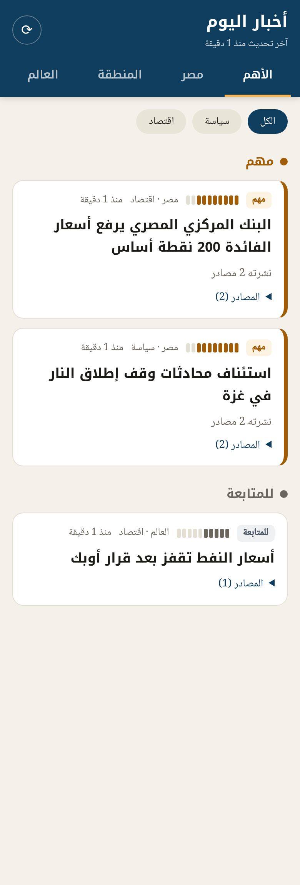

# أخبار اليوم — نسخة شخصية مجانية

تجمع أبرز الأخبار السياسية والاقتصادية عن **مصر** و**المنطقة** و**العالم** من 17 مصدرًا عربيًا وأجنبيًا،
تترجمها للعربية، وترتبها **من الأهم إلى المهم** — **بدون أي تكلفة وبدون سيرفر**.



## كيف تعمل (كلها خدمات مجانية)

```
GitHub Actions (كل 30 دقيقة)
   ← يجلب الأخبار من مصادر RSS
   ← يترجم الأجنبي منها بـ Google Translate المجاني (وMyMemory كبديل) — كل عنوان يُترجم مرة واحدة فقط
   ← يدمج الخبر المكرر من عدة مصادر في خبر واحد
   ← يصنف (سياسة/اقتصاد/تكنولوجيا — مصر/المنطقة/العالم) ويعطي درجة أهمية من 1 إلى 10
   ← ينشر ملف news.json مع الواجهة على GitHub Pages
هاتفك ← يفتح الموقع / التطبيق ويعرض الأخبار
```

**درجة الأهمية** تُحسب بقواعد ثابتة (بدون ذكاء اصطناعي):
- كلمات مفتاحية لها وزن: «البنك المركزي»، «الفائدة»، «التضخم»، «الجنيه»، «صندوق النقد»، «حرب»، «وقف إطلاق النار»، «سد النهضة»...
- عدد المصادر التي نشرت نفس الخبر (كلما زاد، زادت الأهمية).
- الأخبار الخاصة بمصر تأخذ درجة إضافية.
- الأخبار الأحدث تظهر أعلى.
- أخبار الرياضة والفن والمنوعات تُستبعد تلقائيًا.

يمكنك تعديل الكلمات وأوزانها في `builder/rank.py`، والمصادر في `builder/sources.json`.

## خطوات التشغيل (مرة واحدة، حوالي 10 دقائق)

1. أنشئ حسابًا مجانيًا على [github.com](https://github.com) إن لم يكن لديك.
2. أنشئ مستودعًا جديدًا **عامًا (Public)** (مثل `Claude_1`) وارفع إليه ملفات هذا المشروع.
   (GitHub Pages المجاني يعمل فقط مع المستودعات العامة. الكود والأخبار علنية أصلًا، ولا توجد أي بيانات شخصية.)
3. في المستودع: **Settings ← Pages ← Source** واختر **GitHub Actions**.
4. **Actions ← Update news ← Run workflow** لتشغيل أول تحديث.
5. بعد دقيقتين تقريبًا يكون موقعك جاهزًا على: `https://mostafatobgy.github.io/Claude_1/`

## يوتيوب (اختياري)

لإظهار «الأكثر رواجًا على يوتيوب» في تبويب الترند: أنشئ مفتاحًا مجانيًا لـ YouTube Data API v3
وأضفه في **Settings ← Secrets and variables ← Actions** باسم `YOUTUBE_API_KEY`.

## تثبيته على هاتف أندرويد

**الطريقة الأسهل:** افتح رابط موقعك في Chrome ← القائمة ⋮ ← **«تثبيت التطبيق»** (أو «إضافة إلى الشاشة الرئيسية»).
يظهر بأيقونة مثل أي تطبيق، ويعمل بملء الشاشة، ويعرض آخر أخبار محمّلة حتى بدون إنترنت.

**ملف APK:** رابط ثابت لأحدث نسخة: https://github.com/mostafatobgy/Claude_1/releases/download/app/akhbar.apk — أو في GitHub: **Actions ← Build Android APK ← Run workflow** واكتب رابط موقعك،
ثم نزّل الملف من صفحة نتيجة التشغيل وثبّته على الهاتف (ستحتاج السماح بالتثبيت من مصادر غير معروفة).

## الترند

تبويب «🔥 الترند» يعرض أكثر عمليات البحث نموًا الآن من Google Trends (مجاني):
مصر، والمنطقة (السعودية والإمارات والمغرب والأردن)، والعالم (أمريكا وبريطانيا)،
مرتبة حسب حجم البحث، مع ترجمة الموضوع وأبرز خبر عنه. لتغيير الدول: `builder/trends.py`.

وفيه أيضًا «الأكثر صعودًا على ويكيبيديا العربية»: الصفحات التي تضاعفت قراءتها أمس مقارنة بالأيام السابقة
(من بيانات Wikimedia المجانية، `builder/wiki.py`).

## تنبيهات الأخبار العاجلة (مجانية)

عند ظهور خبر جديد في قسم «الأهم» يصلك تنبيه على الهاتف عبر تطبيق **ntfy** المجاني (بدون حساب).

1. ثبّت تطبيق **ntfy** من Google Play.
2. اختر اسم قناة سريًا يصعب تخمينه، مثل `akhbar-` متبوعًا بحروف وأرقام عشوائية.
3. في المستودع: **Settings ← Secrets and variables ← Actions ← New repository secret**
   - Name: `NTFY_TOPIC`
   - Secret: اسم القناة
4. في تطبيق ntfy اضغط **+** واكتب نفس اسم القناة ← Subscribe.

حدود التنبيهات: 3 كحد أقصى في كل تحديث و12 في اليوم، ولا يتكرر تنبيه نفس الخبر. لتعديلها: `builder/notify.py`.

## ملاحظات صريحة

- **المجانية:** GitHub Actions مجاني بلا حدود للمستودعات العامة، وGitHub Pages مجاني. لا توجد أي اشتراكات.
- **الترجمة:** Google Translate المجاني جيد للعناوين لكنه آلي وقد يخطئ أحيانًا. إن رفض Google الطلبات يُستخدم MyMemory، وإن فشلا يظهر العنوان بلغته الأصلية.
- **الترتيب بالقواعد** أقل ذكاءً من الذكاء الاصطناعي؛ قد يرفع خبرًا أو يخفض آخر. عدّل الأوزان في `rank.py` حسب ذوقك.
- **روابط المصادر** لم تُختبر بعد على الإنترنت؛ بعد أول تشغيل افتح سجل Actions وابحث عن `feed failed` لمعرفة المصادر التي تحتاج استبدالًا.
- GitHub قد يؤخر التحديث المجدول بضع دقائق، ويوقفه تلقائيًا إذا لم يحدث أي نشاط في المستودع لمدة 60 يومًا (يُعاد تفعيله بزر واحد من تبويب Actions).

## للمطورين

```bash
pip install -r builder/requirements.txt
python -m pytest -q builder/tests   # اختبارات بدون إنترنت
python builder/build.py             # يكتب site/news.json
cd site && python -m http.server    # http://localhost:8000
```
