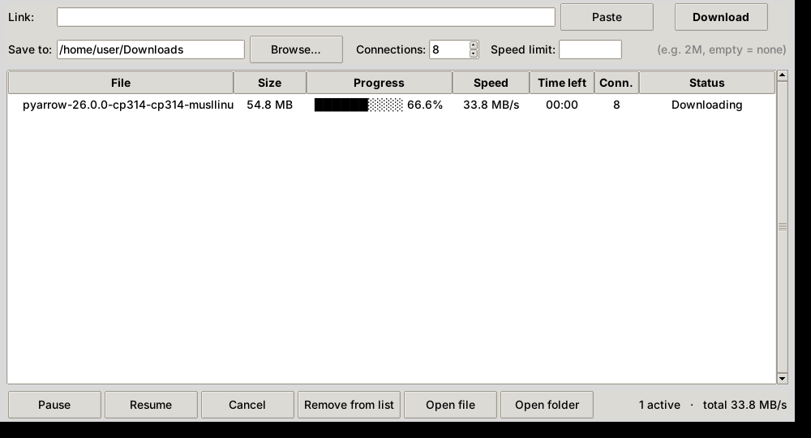
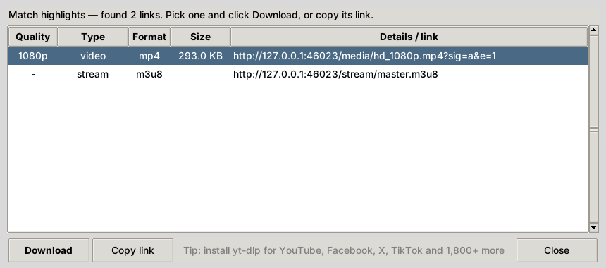
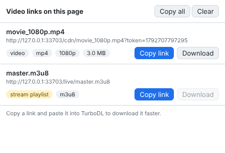

# TurboDL — Download Accelerator

TurboDL downloads big files (movies, ISOs, installers) **faster** by opening several
connections to the server at once, each fetching a different part of the file.
If the download stops — you pause it, close the app, the Wi‑Fi drops, the PC
restarts — it **continues from where it stopped** instead of starting over.

It can also **find the direct link of a video** on a web page, in two ways:
the **Find video…** button in the app, and a **browser extension** that catches
videos while they play. See [Getting video links](#getting-video-links).



## Features

- **Up to 32 connections per file** (8 by default), with *work stealing*: when a
  connection finishes its part early, it takes over half of the slowest part still
  left, so all connections stay busy until the end.
- **Pause / resume**, even after closing the app or rebooting. Unfinished
  downloads reappear in the list next time.
- **Automatic retries** with back-off on dropped connections and server errors.
- **Speed limit** (e.g. `2M`) so downloads don't slow down everything else.
- **SHA‑256 check** (command line) to confirm the file is not damaged.
- Follows redirects, picks the right file name, never overwrites an existing file
  (`movie (1).mp4`), and falls back to a single connection on servers that don't
  support split downloads.
- Desktop window **and** command line. Only the Python standard library — nothing
  else to install.

## Getting video links

Most video pages don't show the real address of the video file. TurboDL finds it
for you.

### 1. “Find video…” in the app (or `turbodl find` on the command line)

Paste the page address and click **Find video…**. You get a list of every video
link on the page with its quality, type and size. Pick one and click **Download**
(it downloads with TurboDL's multiple connections) or **Copy link**.



It looks for the video in this order:

1. **The link is already a video** (`.mp4`, `.webm`, …) or a stream playlist.
2. **[yt-dlp](https://github.com/yt-dlp/yt-dlp)**, which understands 1,800+ sites:
   YouTube, Facebook, Instagram, X/Twitter, TikTok, Vimeo, Dailymotion, Reddit and
   more. It is built into the ready-made apps; from source, run `pip install yt-dlp`.
3. **A scan of the page** for video players (`<video>`/`<source>`), sharing tags
   (`og:video`), search-engine data (JSON-LD) and video addresses inside scripts.
   Each link found is checked with the server, and dead ones are dropped.

```bash
turbodl find https://example.com/some-video-page            # list all links
turbodl find --best https://example.com/some-video-page      # print only the best link
turbodl find --download -d ~/Videos https://example.com/...  # download the best one
turbodl find --json https://example.com/...                  # for other programs
```

### 2. Browser extension (Chrome, Edge, Brave, Opera)

Some players only build the video address while the video plays, so it is not in
the page itself. The extension watches what the tab loads and lists every video
and stream it sees. The toolbar icon shows how many it found.



**Install:** download `TurboDL-browser-extension` from the latest Actions run and
unzip it (or use the `downloader/browser-extension` folder) → open
`chrome://extensions` (or `edge://extensions`) → turn on **Developer mode** → **Load
unpacked** → choose the folder.

**Use:** open the page, **play the video for a few seconds**, then click the TurboDL
icon. Use **Copy link** and paste it into TurboDL, or **Download** to save it with
the browser.

### Types of link you'll see

| Type | Meaning |
|---|---|
| **video** | A complete video file with sound — download it directly. |
| **video only** / **audio only** | Big sites (e.g. YouTube) keep the best quality picture and the sound in separate files. Pick a *video* row to get both together. |
| **stream** (`m3u8`/`mpd`) | A playlist of many small pieces, used for live TV and many players. It plays in VLC (*Media → Open Network Stream*). To save it as one file, use `yt-dlp "<link>"`. |

### Limits

- **Encrypted (DRM) video can't be downloaded** — Netflix, Disney+, Amazon Prime,
  OSN+, paid Shahid and similar. The tool reports this and does not try to get
  around it.
- Many links are **signed and expire** after some hours, or work only from your
  own connection. Download soon after you find them.
- Sites change often. If a site stops working, update yt-dlp
  (`pip install -U yt-dlp`, or download the latest app build, which is rebuilt
  every week). For YouTube, yt-dlp may also need [Deno](https://deno.com) installed.
- Only download videos you have the right to save: your own, freely licensed
  ones, or ones the site allows you to download.

## How much faster?

It depends on where the bottleneck is:

| Situation | Effect |
|---|---|
| The server or CDN limits the speed **per connection** (very common for file hosts and big downloads) | Large speed-up — often 3–8× |
| Long distance / high latency to the server | Noticeable speed-up |
| Your internet plan is already fully used by one connection | No speed-up — nothing can exceed your line speed |

In a test against a real server, a 55 MB file took 9.7 s with one connection and
5.5 s with eight.

## Get the app

**Windows / macOS / Linux, ready to run:** open the repository's **Actions** tab →
*TurboDL (test and build apps)* → the latest run → **Artifacts**, and download
`TurboDL-Windows` (a single `TurboDL.exe`), `TurboDL-macOS` or `TurboDL-Linux`.

**From source** (Python 3.10+):

```bash
cd downloader
python TurboDL.pyw            # open the window (or double-click TurboDL.pyw)
python -m turbodl URL         # command line
pip install ".[video]"        # optional: adds `turbodl` and `turbodl-gui` commands + yt-dlp
```

On Linux the window needs Tk: `sudo apt install python3-tk`.

## Using the window

1. Copy a download link, click **Paste**, then **Download** (or press Enter).
2. Pick the folder under **Save to** and the number of **Connections** (8 is a good
   start; try 16 for slow servers).
3. Select a row to **Pause**, **Resume**, **Cancel** (deletes the partial file) or
   **Open** the finished file. Double-click a finished row to open it.

Settings and unfinished downloads are kept in `~/.turbodl/settings.json`.

## Command line

```bash
turbodl https://example.com/movie.mkv                     # save in current folder
turbodl -c 16 -d ~/Videos https://example.com/movie.mkv   # 16 connections, chosen folder
turbodl -l 2M URL                                         # limit to 2 MB/s
turbodl --sha256 <checksum> URL                           # verify after download
turbodl -H "Cookie: session=abc" URL                      # links that need a login cookie
turbodl URL1 URL2 URL3                                    # several files, one after another
```

Press **Ctrl+C** to pause; run the same command again to continue.

## How it works

1. A tiny request (`Range: bytes=0-0`) finds the size, file name, and whether the
   server allows partial downloads.
2. A `<name>.part` file of the full size is created and split into pieces, one per
   connection; each connection downloads its piece and writes it into place.
3. Progress is saved every 2 seconds to `<name>.part.turbodl`. On resume, the
   saved pieces are checked against the server's `ETag`/`Last-Modified`, so a file
   that changed on the server is never mixed with the old one.
4. When everything has arrived (and the checksum matches, if given), `.part` is
   renamed to the final name.

## Tests

```bash
cd downloader && pip install pytest yt-dlp && python -m pytest -q
# browser extension, in a real Chromium:
cd browser-extension && npm install --no-save playwright && npx playwright install chromium && node test/run.mjs
```

The tests run a local server that supports partial downloads and limits each
connection's speed, and check parallel download, speed-up, work stealing, retries,
pause/resume across restarts, cancel, redirects, file naming and checksums. The
video-finder tests use sample pages built the way real sites build theirs (HTML5
players, links in scripts, JSON-LD, DRM players), and the extension test plays
such a page in Chromium.
